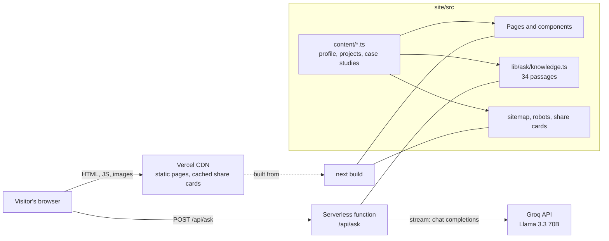
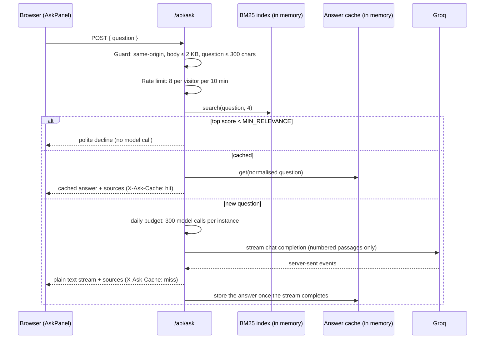

# Architecture

How the portfolio site (`site/`) is built and why. Written 2026-11-01. The visual rules live in [design-system.md](design-system.md).

## In one paragraph

A Next.js 16 app on Vercel. Every page is prerendered to static HTML at build time and served from the CDN; there is no database. One server route, `POST /api/ask`, powers the "Ask about my work" assistant: it ranks passages of the site's own content with BM25, declines off-topic questions without calling a model, answers repeats from an in-memory cache, and otherwise streams an answer from Groq that may cite only those passages. All content lives in typed TypeScript modules, so the pages, the assistant's knowledge, the sitemap and the share images can't disagree.

## System overview



## How a page request works

1. The CDN returns prerendered HTML. Nothing is rendered per request (`○` and `◐` in the build output), and the security headers below are attached to every response.
2. The browser paints the hero straight away: the headline needs no JavaScript, and the portrait is preloaded because it's the largest element (LCP).
3. React hydrates the interactive parts: nav, theme toggle, card tilt, Ask button.
4. three.js loads only on desktop, and only when the Skills panel scrolls into view. Phones never download it.

## How "Ask about my work" answers



| Decision | Why | Trade-off |
|---|---|---|
| BM25 keyword retrieval, not embeddings | The corpus is ~34 short passages written by one person. Measured on a labelled set (below), BM25 plus two small additions gets an answering passage into the model's context for every question, needs no second API key, and builds in about a millisecond | Weaker on paraphrases with no shared words; a short synonym map covers the ones the evaluation found. `retrieve.ts` exposes `search()`, so a vector index can replace it without touching the route |
| Decline below `MIN_RELEVANCE` before calling the model | Off-topic questions cost nothing and can't be talked into answering | The threshold was tuned by hand on real questions (`ask.test.ts` locks them in) |
| Groq, streamed | Fast first token on a free tier; streaming makes the answer appear as it's written | Free-tier limits, handled by the budget and friendly 429s |
| Answer cache keyed by the normalised question | Most visitors click the same suggested questions; repeats are instant and free | Per instance, 12-hour TTL, 200 entries. Content changes only on deploy, which starts fresh instances |
| Abort the model call when the visitor leaves | Closing the chat stops generation, so no quota is spent on unread answers | None |
| Sources in a response header | The body stays a plain text stream the browser can append as it arrives | Header size limits; four short titles fit easily |

### Retrieval quality, measured

`src/lib/ask/retrieval-eval.test.ts` holds 26 labelled recruiter questions, each with the passages that can answer it, plus off-topic questions that must be declined. `npm run eval:ask` prints the per-question table.

| | recall@4 | hit@1 | MRR |
|---|---|---|---|
| Before (2026-11-01) | 73% | 62% | 0.679 |
| After | **100%** | **81%** | **0.897** |

recall@4 is the number that matters most: the route sends the top four passages to the model, so a miss there means no correct answer is possible.

The evaluation found three kinds of failure, each fixed at its cause:
1. **Missing content.** The hobby list was on the page but not in the assistant's knowledge, and the "currently learning" note was copied into four skill passages, which diluted it. Both now live once, in the story passage.
2. **Vocabulary gaps.** Recruiters say "database", "mobile apps" and "relocation"; the content says "MongoDB", "React Native" and "on-site". A small, specific synonym map expands those query terms only, so off-topic questions still match nothing.
3. **Ranking.** "What is Signal?" ranked Signal's "what I'd do next" section above its overview. A title-coverage bonus (a light BM25F) now rewards the passage whose title the question covers most. Its weight was chosen by sweeping 0–4: 0.75 was best, and heavier weights let section words like "How it *works*" outrank "remote *work*".

The test fails if recall@4 drops below 100%, hit@1 below 80% or MRR below 0.85, or if any labelled question would be declined.

### Failure modes

| What fails | What the visitor sees | Status |
|---|---|---|
| No `GROQ_API_KEY` | "The assistant isn't switched on yet…" | 503 |
| Too many questions from one visitor | "Try again in about N minutes" plus `Retry-After` | 429 |
| Daily instance budget used | "Reached today's limit… email Sidd" | 429 |
| Groq rate-limits us | "The AI service is busy… try again in a minute" | 429 |
| Groq down, slow (> 20 s) or erroring | "Couldn't reach the AI service…" | 502 |
| Question from another website | "Only answers questions asked on Sidd's site" | 403 |
| Oversized or empty request | Asked to type a shorter or any question | 413 / 400 |

The rest of the site never depends on the assistant: every answer it gives links to a page that already shows the same content.

## Content as the single source of truth

`src/content/` holds typed data: `profile.ts` (bio, contact, jobs, skills, resume path), `projects.ts` (cards) and `case-studies.ts` (full write-ups and screenshots). Everything else reads from it:

- pages and components render it;
- `lib/ask/knowledge.ts` turns it into the assistant's passages, deliberately leaving out the phone number and graduation details;
- `sitemap.ts` lists one URL per case study;
- the share cards take each case study's name and tagline.

Adding a project is one entry in `projects.ts` and one in `case-studies.ts`.

`content/content.test.ts` checks the content before it ships:
- every project has exactly one case study, in the same order;
- every screenshot file exists, and its real pixel size matches the `width`/`height` written next to it (a mismatch means layout shift or a distorted image);
- every screenshot has real alt text and a caption;
- the resume and the hero portrait exist;
- project links use https.

A separate test fails if the assistant's links point at a section that doesn't exist.

## Security and privacy

- **Headers** (`lib/securityHeaders.ts`, applied in `next.config.ts`): `nosniff`, `DENY` framing, a strict referrer policy, camera/mic/location switched off, HSTS. In production, a Content-Security-Policy allows only this origin for scripts, styles, fonts, images and fetches.
  - It permits inline scripts because Next's bootstrap and the theme script are inline. A nonce-based CSP would remove that, but it forces every page to render per request and gives up static prerendering. For a site with no user accounts and no third-party scripts, that's the wrong trade.
  - Checked in Chrome against a production build: no violations, and WebGL still loads.
- **The API key never reaches the browser.** Only the server route calls Groq; the key lives in Vercel's environment variables or a git-ignored `.env.local`.
- **Abuse:** a same-origin check stops other websites spending the quota; a body-size cap, a per-visitor rate limit and a per-instance daily budget bound the rest.
- **Privacy:**
  - The phone number is assembled in the browser after hydration, so it never appears in the HTML that scrapers read.
  - The assistant's knowledge excludes it.
  - Logs never contain the question text.

## Dependencies and delivery

- **Patched framework.** On 2026-11-01 `npm audit` reported a critical advisory group against the installed Next.js 16.4.0, including unauthenticated remote code execution in image optimisation and in `use cache` functions, both of which this site uses. The site now runs 16.4.3, a patch release in the same line, with exact pinning. `npm audit --omit=dev` reports 0 vulnerabilities.
- **CI** (`.github/workflows/ci.yml`): every push and pull request runs lint, type check, all tests (including the design-system, content and retrieval-evaluation guards), a production build, and `npm audit --omit=dev --audit-level=high`. Read-only token permissions; superseded runs are cancelled.
- **Dependabot** (`.github/dependabot.yml`): weekly pull requests for npm (minor and patch releases grouped) and for the workflow's actions, so security patches arrive on their own and go through CI before merging.
- **One local command**, `npm run check`, runs the same gates as CI except the audit. The Node version is pinned in `.nvmrc` (26); `package.json` declares the minimum Next.js needs (`>=20.9.0`).

## Observability

`/api/ask` writes one JSON line per request, which appears in Vercel's log viewer:

```json
{"event":"ask","outcome":"cache_hit","ms":3,"topScore":7.42}
```

`outcome` is one of `invalid`, `forbidden`, `rate_limited`, `off_topic`, `cache_hit`, `disabled`, `budget_exhausted`, `upstream_busy`, `upstream_error` or `streamed`. Filtering by outcome answers the useful questions:
- how often answers come from the cache;
- whether visitors hit limits;
- whether Groq is failing.

## Performance

- Static HTML from the CDN; fonts self-hosted by `next/font` (no third-party requests).
- Images through `next/image` (AVIF/WebP at the size needed). The hero portrait is preloaded.
- three.js (the largest dependency) is split into its own chunk and loaded only on desktop when the Skills panel is visible.
- Share cards are generated on first request and cached by the CDN for a year (`s-maxage`), so they're rendered roughly once per deploy.

## Configuration

See [`site/.env.example`](../.env.example):

| Variable | Needed for | Default |
|---|---|---|
| `GROQ_API_KEY` | The assistant's answers | Unset: the assistant explains it's off (503) |
| `GROQ_MODEL` | Choosing the model | `llama-3.3-70b-versatile` |
| `NEXT_PUBLIC_SITE_URL` | Absolute URLs in the sitemap, robots and share cards | Vercel's production URL, else `http://localhost:3000` |

## Limits, and how this would scale

The rate limiter and the answer cache live in each serverless instance's memory. At portfolio traffic that's the right call: there's no extra service to run, and the worst case (a visitor spread across several warm instances) only loosens the limits a little.

If traffic ever made it matter, the next steps are:
1. **A shared store for limits and cache.** Upstash Redis or Vercel KV makes both exact across instances. They sit behind small interfaces (`RateLimiter`, `AnswerCache`), so swapping the store doesn't touch the route.
2. **Embeddings for retrieval,** once the corpus grows past what keyword matching handles. The index is built at deploy time, so this adds no per-request latency.
3. **A nonce-based CSP,** if the site ever adds user accounts or third-party scripts.

## Testing

`npm test` runs 169 tests (as of 2026-11-01). They cover:
- retrieval quality: a labelled evaluation with recall, hit@1 and MRR floors, plus off-topic declines;
- content integrity: screenshots, sizes, alt text, links;
- the knowledge privacy rules;
- the route's every outcome, including the cache, cross-site, size and abort paths;
- the answer cache and rate limiter;
- SSE parsing;
- security headers;
- the sitemap and robots;
- components, including keyboard and screen-reader behaviour;
- the design-system guards: WCAG contrast in both themes, token-only styles, the tier boundary, the TypeScript palette mirror, and no dead tokens.
